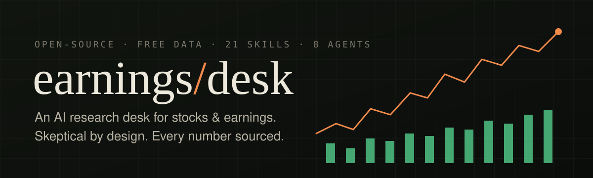

<p align="center">
  
</p>

<p align="center">
  <b>20 Claude skills · 8 specialist agents · zero paid data</b><br>
  Turn Claude into a skeptical buy-side research desk that reads the SEC filings and checks the math for you.
</p>

<p align="center">
  <a href="#quick-start">Quick start</a> ·
  <a href="#how-to-use-it">How to use it</a> ·
  <a href="#the-20-skills">Skills</a> ·
  <a href="#the-desk-deep-dive">Agents</a> ·
  <a href="#examples">Examples</a> ·
  <a href="#troubleshooting">Troubleshooting</a>
</p>

---

## What is this?

**earnings-desk** is a collection of [Claude skills](https://agentskills.io): instruction packs that teach Claude how to do professional stock and earnings research. Install it once, then ask things like *"did Apple beat?"*, *"any accounting red flags at NVIDIA?"* or *"what growth is priced into Microsoft?"*. Claude follows the matching skill step by step:

- **Primary sources.** It pulls official SEC EDGAR filings and financial data for free, with no API key.
- **Real analysis.** It runs the checks a professional analyst would: beat quality, guidance credibility, forensic scores, reverse DCF and more.
- **Shareable reports.** It writes a polished HTML report (light/dark mode, charts) plus Markdown, and every number links back to its source.

There's no app to run, no server and no `pip install`. It's just skills: Markdown instructions, plus a few small standard-library Python helpers inside the skill folders that fetch SEC data.

```text
> /earnings-desk:deep-dive NVDA

  ▸ data-analyst        pulled 6y XBRL, 10-K risk factors, latest release, Form 4s
  ▸ earnings-analyst    ┐
  ▸ forensic-accountant │ working in parallel…
  ▸ valuation-analyst   │
  ▸ industry-analyst    ┘
  ▸ bull-analyst  vs  bear-analyst   rebuttal round
  ▸ portfolio-manager   verdict + kill criteria

  ✔ earnings-desk-reports/NVDA-deep-dive-2026-11-16.html
```

---

## Quick start

**1. Install** (in your terminal, with [Claude Code](https://claude.com/claude-code) installed):
```bash
claude plugin marketplace add MozartofCode/Earnings-Intelligence-Agent
```
```bash
claude plugin install earnings-desk@earnings-desk
```

**2. Identify yourself to the SEC.** It's free, but the SEC requires automated tools to send a name and email. Add this line to your shell profile (`~/.zshrc` or `~/.bashrc`), then open a new terminal:
```bash
export SEC_USER_AGENT="Your Name you@example.com"
```

**3. Start Claude Code and ask:**
```text
/earnings-desk:help
```
or just type a question in plain English: *"Did Apple beat last quarter? Was it a quality beat?"*

Your reports appear in an `earnings-desk-reports/` folder in whatever directory you started Claude in. Open the `.html` file in your browser.

---

## Installation options

### Claude Code (recommended)
This gets everything: all 20 skills, the 8-agent desk and slash commands.

From your terminal:
```bash
claude plugin marketplace add MozartofCode/Earnings-Intelligence-Agent
```
```bash
claude plugin install earnings-desk@earnings-desk
```
Or from inside a Claude Code session: type `/plugin marketplace add MozartofCode/Earnings-Intelligence-Agent`, then `/plugin install earnings-desk@earnings-desk`.

Check it worked:
```bash
claude plugin details earnings-desk
```

### Other AI coding agents (Cursor, Codex, Gemini CLI, …)
The skills follow the open Agent Skills format, so the `skills` CLI can install them into most agents:
```bash
npx skills add MozartofCode/Earnings-Intelligence-Agent
```
It shows a picker. Choose all skills, or just the ones you want. **Always include `sec-edgar`**, because the other skills use its data tools. The multi-agent `deep-dive` works best in Claude Code; other agents run its phases one after another.

### Claude.ai / Claude Desktop
1. Download this repo as a zip (**Code → Download ZIP** on GitHub) and unzip it.
2. Open `plugins/earnings-desk/skills/`. Each folder there is one skill.
3. Zip the skill folder you want (e.g. `earnings-recap/`) and upload it under **Settings → Capabilities → Skills**. Upload `sec-edgar` too.
4. **To make a data-driven skill self-contained:** before zipping, copy `sec-edgar/scripts` and `sec-edgar/assets` into `<skill>/vendor/sec-edgar/`. For `reverse-dcf`, `forensic-accounting` and `comps-valuation`, also copy `financial-statements/scripts` into `<skill>/vendor/financial-statements/`. The scripts find these automatically.

Claude.ai needs code execution with internet access turned on for the scripts to reach sec.gov. Without it, the skills fall back to web search and say so.

---

## Setup details

| Setting | Required? | What it does | How to get it |
|---|---|---|---|
| `SEC_USER_AGENT` | **Yes** | Lets the tools download SEC filings (the SEC blocks anonymous scripts) | Just your name and email: `"Jane Doe jane@example.com"` |
| `FINNHUB_API_KEY` | Optional | Consensus EPS estimates, earnings surprise history, earnings dates, reliable quotes | Free at [finnhub.io/register](https://finnhub.io/register) |
| `FMP_API_KEY` | Optional | Consensus revenue/EPS estimates, earnings calendar, quotes | Free tier at [financialmodelingprep.com](https://site.financialmodelingprep.com/developer/docs) |
| `ALPHAVANTAGE_API_KEY` | Optional | Earnings surprise history | Free at [alphavantage.co](https://www.alphavantage.co/support/#api-key) |

Put them in your shell profile as `export NAME="value"`. A template is in [`.env.example`](.env.example).

**Without any keys everything still works:**
- SEC data never needs a key.
- Prices come from a public endpoint on a best-effort basis (it can rate-limit).
- Consensus estimates come from web search, and the report labels them that way.

Ask `/earnings-desk:help` and it will tell you which keys are set.

Requirements: Python 3.8 or newer (preinstalled on macOS and most Linux). Nothing else.

---

## How to use it

### Two ways to run a skill
1. **Slash command**, the most direct: `/earnings-desk:<skill> TICKER [options]`
   ```text
   /earnings-desk:earnings-recap AAPL
   /earnings-desk:reverse-dcf MSFT
   /earnings-desk:deep-dive NVDA --quick
   ```
2. **Plain English.** Claude picks the right skill from your wording:
   ```text
   Was Amazon's last quarter a real beat or just a tax-rate beat?
   Are insiders at Palantir buying or selling?
   What changed in Tesla's risk factors since last year?
   ```

### What you get back
- **A short answer in chat:** the verdict, the key numbers and the biggest risk.
- **A full report** at `earnings-desk-reports/<TICKER>-<skill>-<date>.html` (open it in a browser; it has charts, tables, a theme toggle and is printable), plus a `.md` copy for your notes.
- **Sources for every number:** SEC accession numbers, filing links, or "web search: site, date" for anything that didn't come from a filing.

### Files it creates (in the folder you run Claude from)
| Path | What |
|---|---|
| `earnings-desk-reports/` | Finished HTML and Markdown reports |
| `.earnings-desk/cache/` | Cached SEC downloads, so repeat runs are fast (safe to delete) |
| `.earnings-desk/runs/<TICKER>-<date>/` | A deep dive's working files: data pack, analyst memos, debate, PM decision |
| `.earnings-desk/theses/<TICKER>.md` | Your saved thesis and kill criteria from `thesis-tracker` |

Tip: keep a dedicated folder for research (e.g. `~/research`) and start Claude there.

### A typical session (illustrative, not real output)
```text
you    > /earnings-desk:company-tearsheet COST
claude > one-page snapshot: business, 5-year financials, valuation, bull/bear points
you    > looks interesting, do the full workup
claude > (runs /earnings-desk:deep-dive COST: 8 analysts, about 15–40 min)
         Research view: Fairly valued · Medium conviction · kill criteria listed
you    > save the thesis
claude > (runs thesis-tracker, writes .earnings-desk/theses/COST.md)
...three months later, after earnings...
you    > /earnings-desk:thesis-tracker COST
claude > Thesis: Intact. Membership renewals 90.4% vs your 89% floor ✔
```

---

## The 20 skills

| Group | Skill | What it answers | Try |
|---|---|---|---|
| **Start here** | [`help`](plugins/earnings-desk/skills/help/SKILL.md) | What can this do? Which skill fits my question? Is my setup OK? | `/earnings-desk:help` |
| | [`deep-dive`](plugins/earnings-desk/skills/deep-dive/SKILL.md) | The full research process with all 8 agents, ending in an investment memo | `/earnings-desk:deep-dive NVDA` |
| **Data & foundations** | [`sec-edgar`](plugins/earnings-desk/skills/sec-edgar/SKILL.md) | Raw SEC data: financials, filings, press releases, insider trades | "Pull Apple's last 12 quarters" |
| | [`company-tearsheet`](plugins/earnings-desk/skills/company-tearsheet/SKILL.md) | One-page snapshot of any company | `/earnings-desk:company-tearsheet COST` |
| | [`financial-statements`](plugins/earnings-desk/skills/financial-statements/SKILL.md) | Margins, growth, returns on capital, cash conversion, balance sheet | `/earnings-desk:financial-statements MSFT` |
| | [`filing-diff`](plugins/earnings-desk/skills/filing-diff/SKILL.md) | What changed in the 10-K/10-Q vs. last year (risk factors, MD&A) | `/earnings-desk:filing-diff TSLA` |
| **Earnings season** | [`earnings-preview`](plugins/earnings-desk/skills/earnings-preview/SKILL.md) | Before the print: expectations, the real bar, implied move, scenarios | `/earnings-desk:earnings-preview NVDA` |
| | [`earnings-recap`](plugins/earnings-desk/skills/earnings-recap/SKILL.md) | After the print: beat/miss, guidance, *quality* of the beat | `/earnings-desk:earnings-recap AAPL` |
| | [`transcript-decoder`](plugins/earnings-desk/skills/transcript-decoder/SKILL.md) | Call tone, hedging language, evasive answers | `/earnings-desk:transcript-decoder AMZN` |
| | [`guidance-tracker`](plugins/earnings-desk/skills/guidance-tracker/SKILL.md) | Does management sandbag or over-promise? | `/earnings-desk:guidance-tracker META` |
| | [`kpi-tracker`](plugins/earnings-desk/skills/kpi-tracker/SKILL.md) | Company-specific metrics over time (subscribers, NRR, same-store sales…) | `/earnings-desk:kpi-tracker NFLX` |
| | [`read-through`](plugins/earnings-desk/skills/read-through/SKILL.md) | What one company's results mean for peers, suppliers and customers | "What does TSMC's print mean for AMD?" |
| **Forensics & quality** | [`forensic-accounting`](plugins/earnings-desk/skills/forensic-accounting/SKILL.md) | Accounting red flags: Beneish, Altman, Piotroski, accruals, filing evidence | `/earnings-desk:forensic-accounting NVDA` |
| | [`capital-allocation`](plugins/earnings-desk/skills/capital-allocation/SKILL.md) | Are buybacks, M&A and dividends creating value? (A–F grade) | `/earnings-desk:capital-allocation AAPL` |
| | [`insider-ownership`](plugins/earnings-desk/skills/insider-ownership/SKILL.md) | Insider buying and selling, ownership structure | `/earnings-desk:insider-ownership PLTR` |
| **Valuation & competition** | [`reverse-dcf`](plugins/earnings-desk/skills/reverse-dcf/SKILL.md) | What growth is priced in, and is it realistic? | `/earnings-desk:reverse-dcf MSFT` |
| | [`comps-valuation`](plugins/earnings-desk/skills/comps-valuation/SKILL.md) | Cheap or expensive vs. peers, adjusted for growth | `/earnings-desk:comps-valuation CRM` |
| | [`moat-analysis`](plugins/earnings-desk/skills/moat-analysis/SKILL.md) | How durable is the competitive advantage? | `/earnings-desk:moat-analysis V` |
| **Thesis desk** | [`bull-bear-debate`](plugins/earnings-desk/skills/bull-bear-debate/SKILL.md) | Strongest bull and bear cases, rebuttals and a judged verdict | `/earnings-desk:bull-bear-debate TSLA` |
| | [`thesis-tracker`](plugins/earnings-desk/skills/thesis-tracker/SKILL.md) | Save your thesis and kill criteria; re-check them after news | `/earnings-desk:thesis-tracker COST` |

### Playbooks
| Situation | Run, in order |
|---|---|
| New idea | `company-tearsheet` → `deep-dive` → `thesis-tracker` |
| Earnings day | `earnings-preview` (before) → `earnings-recap` → `transcript-decoder` → `guidance-tracker` |
| "Is something off here?" | `forensic-accounting` → `filing-diff` → `insider-ownership` → `capital-allocation` |
| "Is it too expensive?" | `reverse-dcf` → `comps-valuation` → `moat-analysis` |
| Earnings season | `read-through` in sector-scan mode across your watchlist |

---

## The desk (`deep-dive`)

`deep-dive` runs a real research process rather than one giant prompt:

| Phase | Who | What happens |
|---|---|---|
| 1 · Data | `data-analyst` | Pulls and checks the data **once** (financials, filings, releases, prices) so everyone works from the same facts |
| 2 · Analysis | `earnings-analyst`, `forensic-accountant`, `valuation-analyst`, `industry-analyst` | Four specialists work **in parallel**, independently, each writing a sourced memo |
| 3 · Debate | `bull-analyst` vs `bear-analyst` | Each writes the strongest possible case, then rebuts the other's best points |
| 4 · Verdict | `portfolio-manager` | Weighs the evidence, names the 2–4 variables that decide the outcome, sets the view and kill criteria, writes the report |

Options:
- `--quick`: a single-agent take in about 5 minutes.
- `--focus earnings|valuation|forensics`: one lens goes deep and the others are trimmed.
- `--peers A,B,C`: sets the comparison group yourself.

Every intermediate memo is saved in `.earnings-desk/runs/` so you can audit how the verdict was reached.

---

## Examples

Real reports, produced by following the skills on live SEC data. Read the Markdown here, or download the HTML and open it in a browser.

| Report | Verdict | The finding |
|---|---|---|
| [AAPL · earnings-recap, Q4 FY26](examples/AAPL-earnings-recap-2026-11-17.md) ([HTML](examples/AAPL-earnings-recap-2026-11-17.html)) | Print quality: **Mixed** | Revenue and guidance beat, but the $0.11 EPS beat is about equal to a tariff refund plus a lower tax rate; inventory is 2.5× last year's level |
| [NVDA · forensic-accounting, FY26](examples/NVDA-forensic-accounting-2026-11-17.md) ([HTML](examples/NVDA-forensic-accounting-2026-11-17.html)) | Forensic verdict: **Watch** | The "elevated" Beneish score is mostly growth, but $14.4B of goodwill came from a non-exclusive license-and-hire deal |

---

## Updating and removing

```bash
claude plugin marketplace update earnings-desk    # fetch the latest catalog
```
```bash
claude plugin update earnings-desk@earnings-desk  # update the plugin
```
```bash
claude plugin uninstall earnings-desk@earnings-desk
```
```bash
claude plugin marketplace remove earnings-desk
```

---

## Troubleshooting

| Problem | Fix |
|---|---|
| `SEC returned 403 Forbidden` | Set `SEC_USER_AGENT` (name and email) and open a new terminal so it takes effect |
| Skills don't show up after installing | Restart Claude Code or run `/reload-plugins`, then check `claude plugin details earnings-desk` |
| "No quote source reachable" / missing prices | The free public price endpoint is rate-limited. Wait a bit, or add a free `FINNHUB_API_KEY` |
| Consensus estimates missing | Expected without a key. Claude uses web search and labels the source. Add `FINNHUB_API_KEY` or `FMP_API_KEY` for direct data |
| `Unknown ticker` | EDGAR only covers companies that file with the SEC (US-listed, plus foreign issuers filing 20-F) |
| Odd metrics for banks or insurers | Expected. Industrial ratios (gross margin, Altman Z, DCF) don't apply, and the skills switch to bank-appropriate checks |
| `python3: command not found` | Install Python 3.8+ from [python.org](https://www.python.org/downloads/) |

---

## What's in this repo

```
.claude-plugin/marketplace.json     the catalog Claude Code reads (one plugin: earnings-desk)
plugins/earnings-desk/
├── .claude-plugin/plugin.json      plugin name, version, description
├── agents/                         the 8 desk agents (one Markdown file each)
└── skills/                         the 20 skills, one folder each:
    └── <skill>/
        ├── SKILL.md                the instructions Claude follows
        ├── references/             deeper playbooks loaded only when needed
        ├── assets/                 templates (e.g. the HTML report template)
        └── scripts/                small stdlib-Python helpers (SEC data, scores, DCF)
examples/                           sample reports
docs/                               banner and icon images
```

The data helpers all live in the `sec-edgar` skill (`edgar.py`, `market.py`, `render_report.py`). The other skills call them as a sibling folder (`../sec-edgar/scripts/`).

---

## FAQ

**Is it free?** Yes. SEC EDGAR is free and keyless, and the optional API keys are free tiers.

**Which companies work?** Anything that files with the SEC: US-listed companies, plus foreign issuers that file 20-F.

**How accurate is it?** Numbers come straight from filings and are cited, but the analysis is AI-generated, so check the sources before acting. See [DISCLAIMER.md](DISCLAIMER.md).

**Does it give buy/sell advice?** No. It produces research views ("Attractive / Fairly valued / Unattractive") with the evidence and what would change the view. It never gives price targets or trade instructions.

**Can I add or improve a skill?** Yes. See [CONTRIBUTING.md](CONTRIBUTING.md) for the authoring standard.

## License

[MIT](LICENSE). **Not investment advice.**
